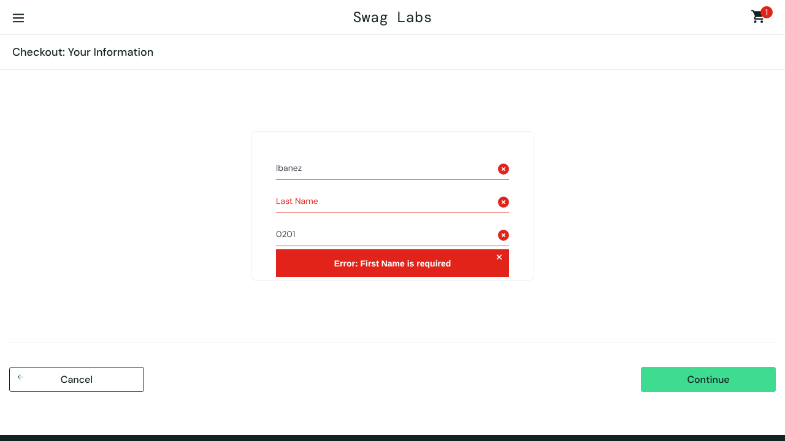
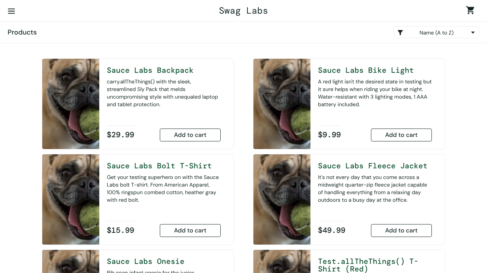
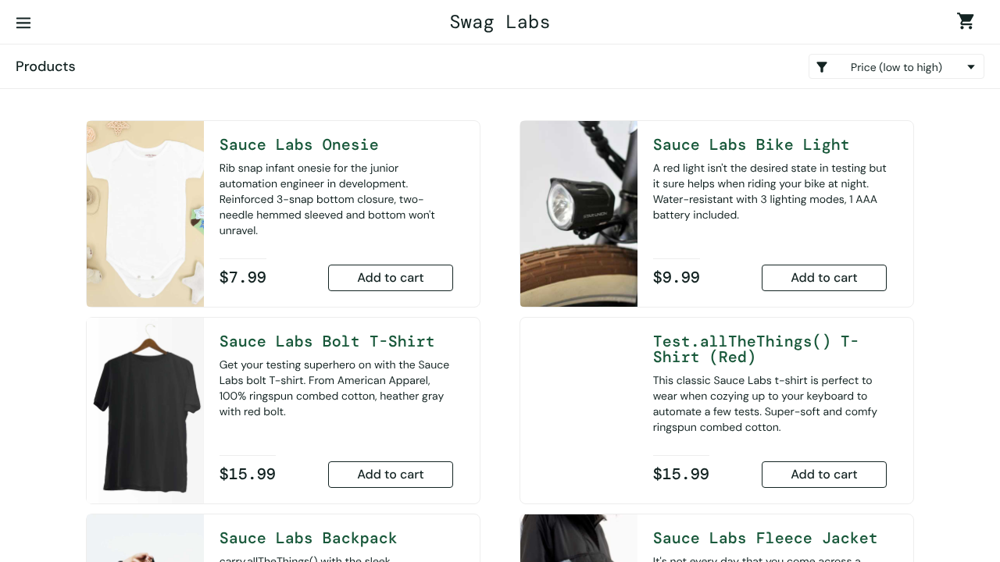

# Bugs encontrados

Defectos reproducibles registrados durante la ejecución de los casos de caja negra. Cada uno tiene su reporte en la plantilla de la materia en esta misma carpeta y un Issue en GitHub.

| ID | Título | Caso | Prioridad | Severidad | Estado |
|---|---|---|---|---|---|
| BUG-001 | El campo Last Name escribe el texto en First Name durante el checkout | TC-005 | Alta | Crítica | Abierto |
| BUG-002 | El ordenamiento por precio de menor a mayor no se aplica en el catálogo | TC-004 | Media | Mayor | Abierto |

## BUG-001 · El campo Last Name escribe el texto en First Name durante el checkout

**Descripción:** En el primer paso del checkout de https://www.saucedemo.com/ (Checkout: Your Information), al escribir en el campo Last Name con el usuario problem_user, el texto se registra en el campo First Name y reemplaza el nombre ya ingresado. Last Name queda vacío y el sistema impide continuar con la compra.

Precondiciones: sesión iniciada con problem_user / secret_sauce y un producto en el carrito.
Datos: First Name = Juan, Last Name = Ibanez, Zip/Postal Code = 0201.

**Pasos para reproducir**

1. Ingresar a https://www.saucedemo.com/ con problem_user / secret_sauce
2. Presionar Add to cart en Sauce Labs Backpack
3. Abrir el carrito y presionar Checkout
4. Escribir Juan en First Name
5. Escribir Ibanez en Last Name
6. Escribir 0201 en Zip/Postal Code y presionar Continue
Referencia: TC-005

**Resultado actual:** First Name muestra Ibanez, Last Name queda vacío y al presionar Continue aparece el mensaje "Error: Last Name is required". No es posible avanzar al resumen de la compra.

**Resultado esperado:** Cada campo debe conservar su propio valor (First Name = Juan, Last Name = Ibanez) y, al presionar Continue, el sistema debe avanzar a Checkout: Overview.

**Prioridad:** Alta 1-5 🡪 1 · **Severidad:** Crítica 1-5 🡪 1

**Ambiente:** Dispositivo = PC/LAPTOP · Navegador = Chromium 141 · resolución 1280x720 · Usuario = problem_user · Versión del software = No aplica (sitio de demostración)

**Evidencia:**

**Comentario:** El defecto bloquea por completo el flujo de compra, por eso se clasifica como crítico. Con standard_user el mismo flujo termina correctamente, lo que ayuda a ubicar el problema en el manejo de los campos del formulario. Se recomienda revisar el enlace entre cada campo y su variable, y volver a ejecutar TC-005 después de la corrección.

Reporte en plantilla: [`BUG-001.docx`](BUG-001.docx)

## BUG-002 · El ordenamiento por precio de menor a mayor no se aplica en el catálogo

**Descripción:** En el catálogo de productos de https://www.saucedemo.com/, al seleccionar la opción Price (low to high) con el usuario problem_user, los productos no cambian de orden y el filtro vuelve a mostrar Name (A to Z).

Precondiciones: sesión iniciada con problem_user / secret_sauce en la página de productos.
Datos: opción de ordenamiento Price (low to high).

**Pasos para reproducir**

1. Ingresar a https://www.saucedemo.com/ con problem_user / secret_sauce
2. En la página Products, abrir el filtro de ordenamiento
3. Seleccionar Price (low to high)
4. Observar el orden de los precios
Referencia: TC-004

**Resultado actual:** Los precios permanecen en el orden $29.99, $9.99, $15.99, $49.99, $7.99, $15.99 y el filtro muestra nuevamente Name (A to Z).

**Resultado esperado:** Los productos deben mostrarse de menor a mayor precio ($7.99, $9.99, $15.99, $15.99, $29.99, $49.99) y el filtro debe conservar la opción seleccionada.

**Prioridad:** Media 1-5 🡪 3 · **Severidad:** Mayor 1-5 🡪 3

**Ambiente:** Dispositivo = PC/LAPTOP · Navegador = Chromium 141 · resolución 1280x720 · Usuario = problem_user · Versión del software = No aplica (sitio de demostración)

**Evidencia:**

**Comentario:** El defecto no impide comprar, pero dificulta encontrar productos por precio y genera desconfianza en el usuario. Se recomienda probar también las demás opciones del filtro, ya que podrían estar afectadas por la misma causa.

Reporte en plantilla: [`BUG-002.docx`](BUG-002.docx)
